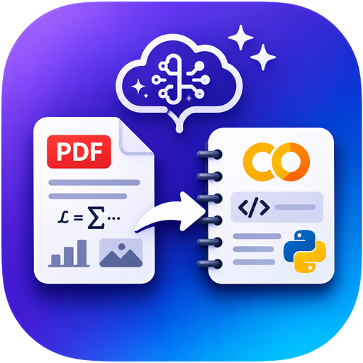

<p align="center">
  
</p>

# Paper to Notebook

Upload a research paper PDF and get back a **Google Colab notebook** that
explains the paper and implements its method in runnable Python.

The PDF is sent directly to an LLM (Anthropic Claude, Google Gemini or OpenAI), which
reads the pages as they are — layout, equations, tables and figures — and
writes the notebook.

Based on the original [VizuaraAI paper-to-notebook](https://github.com/VizuaraAI/paper-to-notebook).

**Improvements over the original:**

- **LLM provider agnostic:** works with Anthropic Claude, Google Gemini or
  OpenAI, chosen with the `PROVIDER` environment variable.
- **Better UI:** a dashboard with separate panels for configuration,
  upload, live LLM output and downloads.
- **Metrics:** token usage, estimated cost, time taken, and details of the
  PDF and the generated `.ipynb`.

## Overview

The app is a single FastAPI server with a browser dashboard. It has five
parts; only one of them talks to the LLM, and only one talks to the arXiv
MCP server:


| Part | Folder | What it does |
|------|--------|--------------|
| Dashboard | `api/static/` | Two tabbed panels: Paper (Upload, Download, Configuration) and Activity (LLM output, MCP log, Metrics) as plain HTML, CSS and JavaScript modules. `app.js` connects them. |
| API routes | `api/routes/` | One module per panel. They check input, start the conversion, stream progress, serve files and MCP events, and hand the real work to the packages below. |
| arXiv source | `sources/` | Turns an arXiv link or ID into a PDF: asks the arXiv MCP server (`get_abstract`) for the paper, then downloads the PDF from arxiv.org. Logs every step for the MCP log tab. |
| Conversion | `notebook_builder/` | Sends the PDF with a prompt and a JSON schema to the provider, then turns the JSON reply into a Colab `.ipynb`. |
| LLM providers | `providers/` | One class per vendor (Anthropic, Gemini, OpenAI) behind a common interface. Handles API keys, retries and progress updates. `factory.py` picks one from `PROVIDER`. |

Shared helpers live in `util/`: loading `config.toml`, cost estimates,
PDF page counts, saving files without overwriting, and logging with API
keys masked.

**One conversion, step by step:**

1. The Upload panel posts the PDF, or an arXiv link, to `/convert/stream`.
2. For an arXiv link, `sources/arxiv.py` starts the arXiv MCP server, calls
   its `get_abstract` tool for the title and PDF URL, and downloads the PDF
   from arxiv.org. Each step appears in the MCP log tab. From here on
   both kinds of input are handled the same way.
3. `convert.py` checks the PDF (PDF header, 15 MB limit) and counts its
   pages.
4. It calls `pdf_to_notebook()` in a worker thread, so the server stays
   responsive during a request that can take minutes.
5. The provider sends the PDF to the LLM API and retries if the API is
   busy or rate limited. While it waits, it reports progress (waiting,
   thinking, writing). Only Claude streams its reply, so Gemini and OpenAI
   show "waiting" until the whole reply arrives.
6. Progress reaches the browser as server-sent events in the LLM output
   panel.
7. The JSON reply is built into a notebook, saved to the output folder,
   priced and added to the session totals.
8. A final `result` event fills the Metrics and Download panels. If
   anything fails, the stream ends with an `error` event instead.

**Configuration** comes from `config.toml` (defaults), an optional
override file named by `PAPER_TO_NOTEBOOK_CONFIG`, and environment
variables, in increasing order of priority. `PROVIDER` and API keys
come only from the environment.

<mark><b>Docs:</b></mark> [docs/index.html](docs/index.html): the overview,
[architecture](docs/architecture.html) and [UI architecture](docs/ui-architecture.html)

<mark><b>Example:</b></mark> [non-linear activation functions.pdf](example/non-linear%20activation%20functions.pdf)
→ [non-linear activation functions.ipynb](example/non-linear%20activation%20functions.ipynb),
a one-page paper with nine equations and the notebook generated from it.
Compare the two to see each formula turned into LaTeX.

## How it works

1. `POST /convert` receives the PDF (max 15 MB), or an arXiv link whose
   PDF is fetched through the arXiv MCP server (see
   [arXiv papers](#arxiv-papers-mcp)).
2. The PDF and an instruction prompt go to the provider selected by
   `PROVIDER`. The model replies with JSON matching a fixed schema: title,
   extra pip packages, whether a GPU is needed, and an ordered list of
   markdown/code cells.
3. `notebook_builder` turns that JSON into a valid `.ipynb` with Colab
   metadata, adding a `!pip install` cell and a GPU runtime when needed.
4. The `.ipynb` is returned as a download named after the uploaded file
   (`my_paper.pdf` → `my_paper.ipynb`). A copy is also saved on the
   server in `$NOTEBOOK_OUTPUT_DIR`, or `~/Downloads` if it is not set (see [Output folder](#output-folder)). Open the notebook in Colab with
   **File → Upload notebook**.

A conversion is a paid API call and usually takes a minute or more.

If the model is busy or rate limited (HTTP 408/429/5xx), the request is
retried automatically, up to 5 attempts with growing delays. If it still
fails, `/convert` returns **503** with a `Retry-After` header — try again a
little later, or switch model with `PROVIDER_MODEL`.
Generated code should be reviewed before you rely on its results.

## Setup

You need Python 3.11+ and an API key for Anthropic, Google Gemini or OpenAI.

1. **Set the environment variables.** Two are **required**, with no
   defaults; the output folder is optional:

   ```bash
   export PROVIDER=anthropic              # or: gemini, openai
   export ANTHROPIC_API_KEY=sk-ant-...    # gemini: GEMINI_API_KEY=...
                                          # openai: OPENAI_API_KEY=...
   export NOTEBOOK_OUTPUT_DIR=~/papers    # optional; default ~/Downloads
   ```

   Add these lines to your shell profile (e.g. `~/.zshrc`) to keep them
   across terminals. API keys are never read from a file.

2. **Dependencies are installed for you.** The first time you run
   `run.py`, it creates a virtual environment in `venv/` and installs
   `requirements.txt` into it. Later runs reuse it. There is no separate
   install step.

   `run.py` does not reinstall into an existing `venv/`, so after pulling
   changes that add dependencies, run
   `venv/bin/pip install -r requirements.txt`.

If a required variable is missing, `run.py` and the server log a warning
at startup naming the variable to export, the dashboard's Configuration
panel shows it in red, and `/convert` returns **503** (before any paid API
call is made) until it is set and the server is restarted.

## Run

```bash
python3 run.py
```

The server starts on port 8000. Open **http://localhost:8000/**, choose a
PDF or paste an arXiv link, and click **Convert to notebook**; the
`.ipynb` downloads when it is ready. Stop the server with `Ctrl+C`. After
changing an environment variable, restart it.

The page is a dashboard with two tabbed panels side by side, sized to fit
the window so nothing needs scrolling on a laptop screen (on narrow
screens they stack):

**Paper** (left):

1. **Upload** (shown by default): pick or drop a PDF, or paste an arXiv
   link or ID (see [arXiv papers](#arxiv-papers-mcp)), choose the notebook
   depth, and start the conversion.
2. **Download** (selected automatically when the notebook is ready): the
   new notebook, the run check result, and every notebook generated since
   the server started. Each one shows how it was made in one line (e.g.
   `anthropic · claude-opus-5-5 · Expert · ✓ checked`), which opens to the
   full recipe: source (upload or arXiv ID), provider, model and speed,
   options, depth, run check, time, tokens and cost. The same recipe is
   saved in the notebook's metadata (`paper_to_notebook`), never with API
   keys.
3. **Configuration**: provider, model, whether the API key was found (and
   in which variable; the key itself is never shown) and the save folder.
   If something is missing, the tab shows a red "!" and opens on load.

**Activity** (right):

4. **LLM output** (shown by default): live stages, an activity log and
   the model's reasoning summary.
5. **MCP log**: every step of an arXiv lookup: the MCP server starting,
   each tool call with its arguments, each result with its timing, the
   PDF download and any error. It polls `GET /api/mcp/events?after=<id>`.
   New events that arrive while another tab is shown appear as a count on
   the tab.
6. **Metrics**: tokens, cost and time; the paper, notebook and
   since-the-server-started figures are under **More details**.
   - tokens and an **estimated cost** (from `[pricing.models]` in `config.toml`;
     fast mode is priced at `fast_multiplier`). Add a line for any model
     you use that isn't listed, such as your Gemini or OpenAI model.
   - how much of the output budget (`max_tokens`) was used
   - time per stage (waiting, thinking, writing, building) and output speed
   - which model and speed actually answered, with a warning if a
     fallback model answered or fast mode fell back to standard speed
   - the paper's page count and tokens per page, plus the notebook's
     size, cells, lines of code, extra packages (and any unsafe ones
     dropped) and whether it needs a GPU
   - totals since the server started (`GET /api/metrics/session`)

These are backed by `GET /api/config` and `GET /api/notebooks` (download
one with `GET /api/notebooks/{id}`; only notebooks this server generated
can be downloaded this way).

The API docs are at `/docs` and a health check at `/health`. From the
command line:

```bash
curl -F "file=@paper.pdf" -OJ http://localhost:8000/convert
curl -F "arxiv=https://arxiv.org/abs/1706.03762" -OJ http://localhost:8000/convert
```

Send either `file` or `arxiv`, not both. `POST /convert/stream` takes the
same form but streams progress as server-sent events (`progress` with the
stage — fetching, waiting, thinking, writing, building — elapsed time,
characters written and Claude's thinking summary; then `result` with the
notebook and its `source`, or `error`). The upload page uses it to show
live status.

## arXiv papers (MCP)

Paste an arXiv link or ID instead of uploading a PDF: `1706.03762`,
`arXiv:1706.03762v7`, `https://arxiv.org/abs/1706.03762` or
`https://arxiv.org/pdf/1706.03762` all work, as do old-style IDs such as
`hep-th/9901001`.

1. The app starts the [arXiv MCP server](https://pypi.org/project/arxiv-mcp-server/)
   (`arxiv-mcp-server`, installed from `requirements.txt`) as a child
   process and talks to it over stdio with the MCP Python SDK. Each lookup
   starts a fresh server and stops it afterwards.
2. It calls the server's `get_abstract` tool, which returns the title,
   authors, abstract and PDF URL.
3. The app downloads that PDF from arxiv.org itself (only arxiv.org URLs
   are used, and the same 15 MB limit applies), and the conversion carries
   on exactly as for an upload: the LLM reads the PDF.

The server's own text extraction (`download_paper`) is not used, so
equations, figures and layout reach the LLM as they do for an upload.
The notebook is named after the ID and title, e.g.
`arXiv 1706.03762 Attention Is All You Need.ipynb`.

How the server is started is set under `[arxiv]` in `config.toml`:

```toml
[arxiv]
command = ["{python}", "-m", "arxiv_mcp_server"]   # {python} = this app's Python
timeout = 60                                       # seconds for the lookup
```

For example, `command = ["uvx", "arxiv-mcp-server"]` runs it with uv
instead. The MCP SDK starts the server with a minimal environment, so
your LLM API keys are not passed to it.

## Notebook depth

**Notebook depth** on the Upload panel (or `depth=` on `/convert` and
`/convert/stream`) sets who the notebook is written for, and so how much
it explains compared with how much it implements:

| Depth | Notebook |
|-------|----------|
| `beginner` | Explains the background the paper assumes, defines every symbol, walks through each equation term by term, and builds intuition with tiny examples; short, well-commented code for the core idea only |
| `practitioner` (default) | Balanced: the key ideas in markdown, then the method implemented around the paper's core contribution |
| `expert` | Brief notes on what is new and the key equations; a complete, faithful, vectorised implementation, with the paper's main variants or ablations where they fit |

Depth only changes the system prompt, so it works the same with every
provider. The choice is saved in the notebook's metadata
(`paper_to_notebook.depth`), shown in the Metrics panel, and remembered by
the browser for next time.

## Check that the notebook runs (optional)

Tick **Check that the notebook runs** on the Upload panel (or send
`verify=true` to `/convert` or `/convert/stream`) to test the notebook
before you get it:

1. Every notebook starts with a `QUICK_RUN = False` cell, and the model is
   told to use tiny data and very few epochs when it is `True`. The check
   runs the code cells top to bottom with `QUICK_RUN = True`, so a long
   training run becomes a smoke test of a few seconds. The notebook you
   download still has `QUICK_RUN = False` and runs the full experiment.
2. If a cell fails or runs past `cell_timeout`, its code and error go back
   to the same LLM, which returns fixed cells. The notebook is run again,
   up to `max_repairs` times.
3. A **Run check** tab appears on the right edge when you click Convert.
   It stays collapsed while the model writes the notebook (you can open it
   to see "Waiting for the model to write the notebook…"), then the drawer
   slides open by itself when the check starts. It shows each run cell by
   cell (running, passed with its time and output, or failed with the
   error) and each fix the model made between runs. The panels on the
   left stay usable; **Collapse** (or Esc) folds it back into the tab,
   whose dot shows the status.
4. The result shows under the download link, in the Metrics panel, and as
   a line in the notebook's title cell. Repair tokens count towards the
   cost.

Repairs use the same `LLMProvider` interface as the conversion, so the
check works with Anthropic, Gemini and OpenAI. GPU notebooks are skipped.

**It runs LLM-written code on the server.** The code runs in a separate
Python process with no API keys in its environment, in a throwaway
folder, under per-cell and total timeouts, but it is not a full sandbox:
it can still reach the network and your files. So the check is offered
only to a browser on the same machine (localhost) unless you set
`allow_remote = true`. Leave that off on a shared or public server.

On first use, the check creates a virtual environment in
`~/.cache/paper-to-notebook/verify-env` and installs `base_packages`
(numpy, scipy, pandas, matplotlib, scikit-learn and torch, standing in for
what Colab preinstalls). This takes a few minutes once. Packages a
notebook asks for are installed there too. To use an environment you
already have, set `python`. The settings are under `[verify]` in
`config.toml`:

```toml
[verify]
default = false        # tick the checkbox by default
allow_remote = false   # offer the check to clients not on localhost
skip_gpu = true
cell_timeout = 120     # seconds per cell
total_timeout = 600    # seconds per run of the whole notebook
max_repairs = 2
python = ""            # e.g. "~/miniconda3/envs/ml/bin/python"
```

## LLM providers (Anthropic, Gemini, OpenAI)

[`config.toml`](config.toml) holds the vendor defaults, one table per provider:
`base_url`, `model`, and `api_key_env` (a list of environment variables to read
the key from, checked in order). **API keys are never stored in a file.**

Each setting comes from the first source that has it:

| Setting  | `get_provider()` kwarg | Environment variable | `config.toml` |
|----------|------------------------|----------------------|----------|
| Provider | `name`                 | `PROVIDER` (required) | — |
| Model    | `model`                | `PROVIDER_MODEL`     | `model`  |
| Base URL | `base_url`             | `PROVIDER_BASE_URL`  | `base_url` |
| API key  | —                      | names in `api_key_env` (required) | never  |

Anthropic tuning, set in `[anthropic]` and overridable per run:

| Option | `config.toml` | Environment override | Notes |
|--------|---------------|----------------------|-------|
| Effort | `effort = "medium"` | `PROVIDER_EFFORT` | `low`…`max`; higher thinks longer (slower, more tokens) |
| Speed | `speed = "fast"` | `PROVIDER_SPEED` | `fast` ≈ up to 2.5× faster output at 2× price; falls back to `standard` if busy |
| Max tokens | `max_tokens = 128000` | `PROVIDER_MAX_TOKENS` | shared by thinking and the notebook |

OpenAI (`PROVIDER=openai`, or `gpt` / `chatgpt`) defaults to `gpt-5.5`;
to use another model, set `model` under `[openai]` or
`export PROVIDER_MODEL=<model id>`. The model must accept PDF input. It
uses the Responses API with strict structured output, and sends
`store: false` so OpenAI does not keep the paper or the notebook. Optional
tuning, not sent unless set:

| Option | `config.toml` | Environment override | Notes |
|--------|---------------|----------------------|-------|
| Effort | `effort = "medium"` | `PROVIDER_EFFORT` | reasoning effort: `none`, `minimal`, `low`…`max`; leave unset for models without reasoning |
| Max tokens | `max_tokens = 64000` | `PROVIDER_MAX_TOKENS` | shared by reasoning and the notebook |

OpenAI replies are not streamed, so the dashboard shows "waiting" until the
whole notebook arrives (no live thinking or writing progress). Add the
model's price under `[pricing.models]` to see its cost:

```toml
[pricing.models]
"gpt-5.5" = { input = <USD>, output = <USD> }   # per million tokens
```

Quote model ids that contain a dot.

To change defaults without editing `config.toml`, point
`PAPER_TO_NOTEBOOK_CONFIG` at your own `.toml` file; its values override
`config.toml` key by key, and nested tables such as `[pricing.models]` are
merged, so an override only needs the keys it changes:

```toml
[openai]
model = "gpt-5.5"
effort = "low"
```

The config used to be `config.ini`. An old `.ini` override is rejected
with a message: rename it to `.toml` and quote the string values.

The providers can also be used directly:

```python
from pathlib import Path

from notebook_builder import pdf_to_notebook
from providers import get_provider

result = pdf_to_notebook(Path("paper.pdf").read_bytes(), get_provider())
print(result.filename, len(result.notebook.cells))
```

## Output folder

Every notebook is also saved on the server. `output_dir` under `[app]` in
`config.toml` names the environment variable that holds the folder:

```toml
[app]
output_dir = "NOTEBOOK_OUTPUT_DIR"
```

The variable is optional: if it is not set, notebooks are saved to
`~/Downloads`. `~` and `$VARIABLES` in its value are expanded,
and relative paths are resolved from the project root. Existing files are
never overwritten.

## Logging

The server logs each step of a conversion: which config files were loaded,
the provider, model and base URL (and where each came from), which variable
the API key was found in, the request sent, the reply's stop reason, token
counts and timing, and a summary of the notebook the model returned.

API keys are always masked, e.g. `sk-a…7f2c (34 chars)`. Set
`LOG_LEVEL=DEBUG` to also log the first 500 characters of the model's raw
reply, or `LOG_LEVEL=WARNING` to log only problems.

## Tests

```bash
pytest -v --cov      # fails if coverage drops below 95%
```

The tests use fake LLM clients, so they make no API calls and need no keys.

## Project Structure

```
├── api/
│   ├── main.py             # FastAPI app: middleware, routers, /static
│   ├── settings.py         # Shared constants (upload limit, version…)
│   ├── dependencies.py     # Provider / output-folder checks
│   ├── routes/             # One module per dashboard panel
│   │   ├── dashboard.py    # GET / — assembles the page from the panels
│   │   ├── config.py       # 1 Configuration: /api/config, /health
│   │   ├── convert.py      # 2–4 Upload, LLM output, Metrics: /convert…
│   │   ├── metrics.py      # 4 Metrics: /api/metrics/session
│   │   ├── download.py     # 5 Download: /api/notebooks
│   │   └── mcp.py          # MCP log tab: /api/mcp/events
│   └── static/
│       ├── index.html      # Page shell; one include line per panel
│       ├── base.css        # Theme, grid layout, shared styles
│       ├── shared.js       # Formatting, SSE reader, scroll helpers
│       ├── app.js          # Wires the panels together, runs a conversion
│       └── panels/<name>/  # paper (tabs: upload, download, config),
│                           #   activity (tabs: output, mcp, metrics),
│                           #   check (Run check drawer):
│                           #   <name>.html, <name>.css, <name>.js
├── notebook_builder/
│   ├── prompt.py           # System prompt + JSON schema for the model
│   ├── converter.py        # pdf_to_notebook(): PDF → LLM → notebook
│   ├── builder.py          # JSON spec → Colab .ipynb (nbformat)
│   ├── verify.py           # Optional run check and LLM repairs
│   └── sandbox_runner.py   # Runs the cells in a separate process
├── providers/
│   ├── base.py             # LLMProvider interface, ProviderSettings
│   ├── claude.py           # Anthropic SDK
│   ├── gemini.py           # Google Gen AI SDK
│   ├── openai_provider.py  # OpenAI SDK (Responses API)
│   └── factory.py          # get_provider() from $PROVIDER
├── sources/
│   ├── arxiv.py            # arXiv ID/link → MCP get_abstract → PDF
│   └── mcp_log.py          # MCP event log the dashboard polls
├── util/
│   ├── config.py           # config.toml loader, API key lookup
│   ├── files.py            # Save files without overwriting
│   ├── log.py              # Logging setup, secret masking
│   ├── pdf.py              # Page count
│   ├── pricing.py          # Cost estimate from [pricing]
│   ├── text_utils.py       # Safe filenames
│   └── url_utils.py        # Split API version off base URLs
├── docs/                   # index.html: overview, architecture, UI architecture
├── tests/
├── config.toml             # Provider defaults and prices (no keys)
├── output/                 # Saved notebooks (git-ignored)
├── pyproject.toml
├── requirements.txt
└── run.py                  # Entry point
```

## License

MIT — Part of the Modern Software Developer 2.0 bootcamp by [Vizuara AI](https://vizuara.ai).
