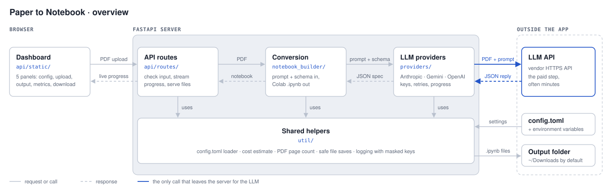

# Paper to Notebook

Upload a research paper PDF and get back a **Google Colab notebook** that
explains the paper and implements its method in runnable Python.

The PDF is sent directly to an LLM (Anthropic Claude, Google Gemini or OpenAI), which
reads the pages as they are — layout, equations, tables and figures — and
writes the notebook.

## Overview

The app is a single FastAPI server with a browser dashboard. It has four
parts, and only one of them talks to the LLM:



| Part | Folder | What it does |
|------|--------|--------------|
| Dashboard | `api/static/` | Five panels (Configuration, Upload, LLM output, Metrics, Download) as plain HTML, CSS and JavaScript modules. `app.js` connects them. |
| API routes | `api/routes/` | One module per panel. They check input, start the conversion, stream progress and serve files, and hand the real work to the packages below. |
| Conversion | `notebook_builder/` | Sends the PDF with a prompt and a JSON schema to the provider, then turns the JSON reply into a Colab `.ipynb`. |
| LLM providers | `providers/` | One class per vendor (Anthropic, Gemini, OpenAI) behind a common interface. Handles API keys, retries and progress updates. `factory.py` picks one from `PROVIDER`. |

Shared helpers live in `util/`: loading `config.toml`, cost estimates,
PDF page counts, saving files without overwriting, and logging with API
keys masked.

**One conversion, step by step:**

1. The Upload panel posts the PDF to `/convert/stream`.
2. `convert.py` checks the file (PDF header, 15 MB limit) and counts its
   pages.
3. It calls `pdf_to_notebook()` in a worker thread, so the server stays
   responsive during a request that can take minutes.
4. The provider sends the PDF to the LLM API and retries if the API is
   busy or rate limited. While it waits, it reports progress (waiting,
   thinking, writing). Only Claude streams its reply, so Gemini and OpenAI
   show "waiting" until the whole reply arrives.
5. Progress reaches the browser as server-sent events in the LLM output
   panel.
6. The JSON reply is built into a notebook, saved to the output folder,
   priced and added to the session totals.
7. A final `result` event fills the Metrics and Download panels. If
   anything fails, the stream ends with an `error` event instead.

**Configuration** comes from `config.toml` (defaults), an optional
override file named by `PAPER_TO_NOTEBOOK_CONFIG`, and environment
variables, in increasing order of priority. `PROVIDER` and API keys
come only from the environment.

Architecture details: [docs/architecture.html](docs/architecture.html)

## How it works

1. `POST /convert` receives the PDF (max 15 MB).
2. The PDF and an instruction prompt go to the provider selected by
   `PROVIDER`. The model replies with JSON matching a fixed schema: title,
   extra pip packages, whether a GPU is needed, and an ordered list of
   markdown/code cells.
3. `notebook_builder` turns that JSON into a valid `.ipynb` with Colab
   metadata, adding a `!pip install` cell and a GPU runtime when needed.
4. The `.ipynb` is returned as a download named after the uploaded file
   (`my_paper.pdf` → `my_paper.ipynb`). A copy is also saved on the
   server in `$NOTEBOOK_OUTPUT_DIR`, or `~/Downloads` if it is not set (see [Output folder](#output-folder)). Open the notebook in Colab with
   **File → Upload notebook**.

A conversion is a paid API call and usually takes a minute or more.

If the model is busy or rate limited (HTTP 408/429/5xx), the request is
retried automatically, up to 5 attempts with growing delays. If it still
fails, `/convert` returns **503** with a `Retry-After` header — try again a
little later, or switch model with `PROVIDER_MODEL`.
Generated code should be reviewed before you rely on its results.

## Setup

You need Python 3.11+ and an API key for Anthropic, Google Gemini or OpenAI.

1. **Set the environment variables.** Two are **required**, with no
   defaults; the output folder is optional:

   ```bash
   export PROVIDER=anthropic              # or: gemini, openai
   export ANTHROPIC_API_KEY=sk-ant-...    # gemini: GEMINI_API_KEY=...
                                          # openai: OPENAI_API_KEY=...
   export NOTEBOOK_OUTPUT_DIR=~/papers    # optional; default ~/Downloads
   ```

   Add these lines to your shell profile (e.g. `~/.zshrc`) to keep them
   across terminals. API keys are never read from a file.

2. **Dependencies are installed for you.** The first time you run
   `run.py`, it creates a virtual environment in `venv/` and installs
   `requirements.txt` into it. Later runs reuse it. There is no separate
   install step.

   `run.py` does not reinstall into an existing `venv/`, so after pulling
   changes that add dependencies, run
   `venv/bin/pip install -r requirements.txt`.

If a required variable is missing, `run.py` and the server log a warning
at startup naming the variable to export, the dashboard's Configuration
panel shows it in red, and `/convert` returns **503** (before any paid API
call is made) until it is set and the server is restarted.

## Run

```bash
python3 run.py
```

The server starts on port 8000. Open **http://localhost:8000/**, choose a
PDF and click **Convert to notebook**; the `.ipynb` downloads when it is
ready. Stop the server with `Ctrl+C`. After changing an environment
variable, restart it.

The page is a dashboard with five panels:

1. **Configuration**: provider, model, whether the API key was found (and
   in which variable; the key itself is never shown) and the save folder.
2. **Upload paper**: pick or drop a PDF and start the conversion.
3. **LLM output**: live stages, an activity log and the model's
   reasoning summary.
4. **Metrics**:
   - tokens and an **estimated cost** (from `[pricing.models]` in `config.toml`;
     fast mode is priced at `fast_multiplier`). Add a line for any model
     you use that isn't listed, such as your Gemini or OpenAI model.
   - how much of the output budget (`max_tokens`) was used
   - time per stage (waiting, thinking, writing, building) and output speed
   - which model and speed actually answered, with a warning if a
     fallback model answered or fast mode fell back to standard speed
   - the paper's page count and tokens per page, plus the notebook's
     size, cells, lines of code, extra packages (and any unsafe ones
     dropped) and whether it needs a GPU
   - totals since the server started (`GET /api/metrics/session`)
5. **Download**: the new notebook, plus every notebook generated since the
   server started.

These are backed by `GET /api/config` and `GET /api/notebooks` (download
one with `GET /api/notebooks/{id}`; only notebooks this server generated
can be downloaded this way).

The API docs are at `/docs` and a health check at `/health`. From the
command line:

```bash
curl -F "file=@paper.pdf" -OJ http://localhost:8000/convert
```

`POST /convert/stream` takes the same upload but streams progress as
server-sent events (`progress` with the stage — waiting, thinking, writing,
building — elapsed time, characters written and Claude's thinking summary;
then `result` with the notebook, or `error`). The upload page uses it to
show live status.

## LLM providers (Anthropic, Gemini, OpenAI)

[`config.toml`](config.toml) holds the vendor defaults, one table per provider:
`base_url`, `model`, and `api_key_env` (a list of environment variables to read
the key from, checked in order). **API keys are never stored in a file.**

Each setting comes from the first source that has it:

| Setting  | `get_provider()` kwarg | Environment variable | `config.toml` |
|----------|------------------------|----------------------|----------|
| Provider | `name`                 | `PROVIDER` (required) | — |
| Model    | `model`                | `PROVIDER_MODEL`     | `model`  |
| Base URL | `base_url`             | `PROVIDER_BASE_URL`  | `base_url` |
| API key  | —                      | names in `api_key_env` (required) | never  |

Anthropic tuning, set in `[anthropic]` and overridable per run:

| Option | `config.toml` | Environment override | Notes |
|--------|---------------|----------------------|-------|
| Effort | `effort = "medium"` | `PROVIDER_EFFORT` | `low`…`max`; higher thinks longer (slower, more tokens) |
| Speed | `speed = "fast"` | `PROVIDER_SPEED` | `fast` ≈ up to 2.5× faster output at 2× price; falls back to `standard` if busy |
| Max tokens | `max_tokens = 128000` | `PROVIDER_MAX_TOKENS` | shared by thinking and the notebook |

OpenAI (`PROVIDER=openai`, or `gpt` / `chatgpt`) defaults to `gpt-5.5`;
to use another model, set `model` under `[openai]` or
`export PROVIDER_MODEL=<model id>`. The model must accept PDF input. It
uses the Responses API with strict structured output, and sends
`store: false` so OpenAI does not keep the paper or the notebook. Optional
tuning, not sent unless set:

| Option | `config.toml` | Environment override | Notes |
|--------|---------------|----------------------|-------|
| Effort | `effort = "medium"` | `PROVIDER_EFFORT` | reasoning effort: `none`, `minimal`, `low`…`max`; leave unset for models without reasoning |
| Max tokens | `max_tokens = 64000` | `PROVIDER_MAX_TOKENS` | shared by reasoning and the notebook |

OpenAI replies are not streamed, so the dashboard shows "waiting" until the
whole notebook arrives (no live thinking or writing progress). Add the
model's price under `[pricing.models]` to see its cost:

```toml
[pricing.models]
"gpt-5.5" = { input = <USD>, output = <USD> }   # per million tokens
```

Quote model ids that contain a dot.

To change defaults without editing `config.toml`, point
`PAPER_TO_NOTEBOOK_CONFIG` at your own `.toml` file; its values override
`config.toml` key by key, and nested tables such as `[pricing.models]` are
merged, so an override only needs the keys it changes:

```toml
[openai]
model = "gpt-5.5"
effort = "low"
```

The config used to be `config.ini`. An old `.ini` override is rejected
with a message: rename it to `.toml` and quote the string values.

The providers can also be used directly:

```python
from pathlib import Path

from notebook_builder import pdf_to_notebook
from providers import get_provider

result = pdf_to_notebook(Path("paper.pdf").read_bytes(), get_provider())
print(result.filename, len(result.notebook.cells))
```

## Output folder

Every notebook is also saved on the server. `output_dir` under `[app]` in
`config.toml` names the environment variable that holds the folder:

```toml
[app]
output_dir = "NOTEBOOK_OUTPUT_DIR"
```

The variable is optional: if it is not set, notebooks are saved to
`~/Downloads`. `~` and `$VARIABLES` in its value are expanded,
and relative paths are resolved from the project root. Existing files are
never overwritten.

## Logging

The server logs each step of a conversion: which config files were loaded,
the provider, model and base URL (and where each came from), which variable
the API key was found in, the request sent, the reply's stop reason, token
counts and timing, and a summary of the notebook the model returned.

API keys are always masked, e.g. `sk-a…7f2c (34 chars)`. Set
`LOG_LEVEL=DEBUG` to also log the first 500 characters of the model's raw
reply, or `LOG_LEVEL=WARNING` to log only problems.

## Tests

```bash
pytest -v --cov      # fails if coverage drops below 95%
```

The tests use fake LLM clients, so they make no API calls and need no keys.

## Project Structure

```
├── api/
│   ├── main.py             # FastAPI app: middleware, routers, /static
│   ├── settings.py         # Shared constants (upload limit, version…)
│   ├── dependencies.py     # Provider / output-folder checks
│   ├── routes/             # One module per dashboard panel
│   │   ├── dashboard.py    # GET / — assembles the page from the panels
│   │   ├── config.py       # 1 Configuration: /api/config, /health
│   │   ├── convert.py      # 2–4 Upload, LLM output, Metrics: /convert…
│   │   ├── metrics.py      # 4 Metrics: /api/metrics/session
│   │   └── download.py     # 5 Download: /api/notebooks
│   └── static/
│       ├── index.html      # Page shell; one include line per panel
│       ├── base.css        # Theme, grid layout, shared styles
│       ├── shared.js       # Formatting, SSE reader, scroll helpers
│       ├── app.js          # Wires the panels together, runs a conversion
│       └── panels/<name>/  # config, upload, output, metrics, download:
│                           #   <name>.html, <name>.css, <name>.js
├── notebook_builder/
│   ├── prompt.py           # System prompt + JSON schema for the model
│   ├── converter.py        # pdf_to_notebook(): PDF → LLM → notebook
│   └── builder.py          # JSON spec → Colab .ipynb (nbformat)
├── providers/
│   ├── base.py             # LLMProvider interface, ProviderSettings
│   ├── claude.py           # Anthropic SDK
│   ├── gemini.py           # Google Gen AI SDK
│   ├── openai_provider.py  # OpenAI SDK (Responses API)
│   └── factory.py          # get_provider() from $PROVIDER
├── util/
│   ├── config.py           # config.toml loader, API key lookup
│   ├── files.py            # Save files without overwriting
│   ├── log.py              # Logging setup, secret masking
│   ├── pdf.py              # Page count
│   ├── pricing.py          # Cost estimate from [pricing]
│   ├── text_utils.py       # Safe filenames
│   └── url_utils.py        # Split API version off base URLs
├── docs/                   # Overview and architecture diagrams
├── tests/
├── config.toml             # Provider defaults and prices (no keys)
├── output/                 # Saved notebooks (git-ignored)
├── pyproject.toml
├── requirements.txt
└── run.py                  # Entry point
```

## License

MIT — Part of the Modern Software Developer 2.0 bootcamp by [Vizuara AI](https://vizuara.ai).
